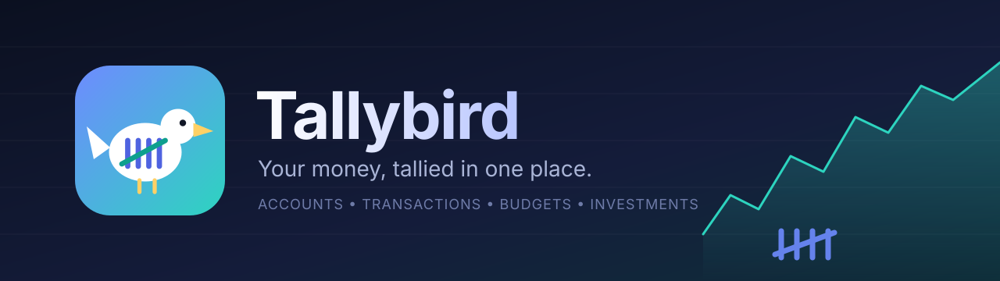
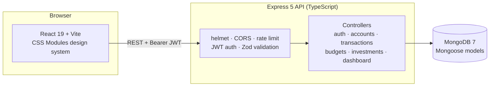

<div align="center">



<br />


# Tallybird

**Your money, tallied in one place.**

A full-stack personal finance dashboard: manage multiple accounts, record income, expenses and transfers, budget by category, and track investments - with a clean, responsive UI and a hardened, well-tested API.

[](https://github.com/Slv-WebTech/personal-finance/actions)
[](LICENSE)


[Quick start](#quick-start) · [Features](#features) · [Architecture](#architecture) · [API](#api-overview) · [Docs](docs/README.md) · [Roadmap](#roadmap)

</div>

---

## Features

<table>
  <tr>
    <td width="50%" valign="top">
      <h3>🏦 Accounts</h3>
      Savings, checking, credit and investment accounts in any currency. Balances change only through transactions, so the ledger and the balance can never disagree.
    </td>
    <td width="50%" valign="top">
      <h3>💸 Transactions &amp; transfers</h3>
      Income, expenses and investments with automatic balance updates. Transfers move money between two of your accounts (a debit and a credit leg, with rollback if anything fails).
    </td>
  </tr>
  <tr>
    <td valign="top">
      <h3>🎯 Budgets</h3>
      Monthly limits per category with live usage, remaining amount and an over-budget flag, computed in a single aggregation query.
    </td>
    <td valign="top">
      <h3>📈 Investments</h3>
      Holdings with quantity, purchase price and current value per unit; profit/loss, return % and portfolio totals.
    </td>
  </tr>
  <tr>
    <td valign="top">
      <h3>🧭 Dashboard</h3>
      A snapshot of balances per currency, this month's income vs. expenses and portfolio value.
    </td>
    <td valign="top">
      <h3>🛡️ Secure by default</h3>
      JWT auth, per-user data isolation on every route, rate-limited sign-in, strict input validation, helmet headers and generic error responses.
    </td>
  </tr>
</table>

Responsive from phone to desktop (tables become cards on small screens), keyboard-accessible dialogs with focus trapping, and clear loading, empty and error states.

## Screenshots

> Screenshots and a short GIF will go here. Drop images into `docs/assets/` and reference them, e.g. ``.

| Dashboard | Transactions | Budgets |
| :---: | :---: | :---: |
| _placeholder_ | _placeholder_ | _placeholder_ |

## Architecture



```
client/   React + TypeScript frontend (Vite)         -> pages, components/ui, services, context
server/   Express + TypeScript API                   -> routes, controllers, models, middleware, utils
docs/     Product, architecture, API, DB, decisions, QA report
.github/  CI workflow, PR and issue templates
docker-compose.yml   MongoDB for development; `--profile app` also runs server + client
```

## Quick start

Requires **Node.js 22+** and either **Docker** or a local **MongoDB 7**.

```bash
# 1. Start MongoDB
docker compose up -d

# 2. Configure environment (generate your own JWT secret - 32+ characters)
cp server/.env.example server/.env
cp client/.env.example client/.env
node -e "console.log(require('crypto').randomBytes(48).toString('hex'))"   # paste into JWT_SECRET

# 3. Install and run (two terminals)
cd server && npm install && npm run dev     # http://localhost:4000
cd client && npm install && npm run dev     # http://localhost:5173

# 4. Check it
curl http://localhost:4000/api/health
```

Open <http://localhost:5173>, create an account, then add accounts, transactions, budgets and investments.

### Everything in Docker

```bash
JWT_SECRET=<32+ random characters> docker compose --profile app up --build
# client http://localhost:8080 · API http://localhost:4000
```

> The Dockerfiles are written but have not yet been verified on a machine with a running Docker engine.

## Environment variables

| App | Variable | Required | Description |
| --- | --- | :---: | --- |
| server | `MONGODB_URI` | yes | MongoDB connection string, e.g. `mongodb://localhost:27017/personal-finance` |
| server | `JWT_SECRET` | yes | Random secret, **at least 32 characters** - the server refuses to start otherwise |
| server | `PORT` | no | API port (default `4000`) |
| server | `CORS_ORIGIN` | no | Allowed browser origin (default `http://localhost:5173`) |
| server (tests) | `TEST_MONGODB_URI` | no | Overrides the test database (default `mongodb://localhost:27017/personal-finance-test`) |
| client | `VITE_API_URL` | no | API base URL (default `http://localhost:4000/api`) |

Only `.env.example` files with placeholder values are tracked; real `.env` files are git-ignored.

## API overview

All routes except `health`, `register` and `login` require `Authorization: Bearer <token>`. Full reference: [`docs/API_DOCUMENTATION.md`](docs/API_DOCUMENTATION.md).

| Resource | Endpoints |
| --- | --- |
| Health | `GET /api/health` |
| Auth | `POST /api/auth/register` · `POST /api/auth/login` · `GET /api/auth/me` |
| Accounts | `GET/POST /api/accounts` · `GET/PUT/DELETE /api/accounts/:id` |
| Transactions | `GET/POST /api/transactions` (filters, `page`, `limit`) · `GET/PUT/DELETE /api/transactions/:id` |
| Budgets | `GET/POST /api/budgets` · `GET/PUT/DELETE /api/budgets/:id` |
| Investments | `GET/POST /api/investments` · `GET/PUT/DELETE /api/investments/:id` |
| Dashboard | `GET /api/dashboard/summary` |

Errors always look like `{ "error": { "message": "…", "details": […] } }`.

## Testing

```bash
cd server && npm test          # 99 tests - Vitest + supertest, needs MongoDB
cd client && npm test          # 6 tests  - Vitest + Testing Library
npm run lint                   # in each app (ESLint / oxlint)
```

CI runs type-check, lint, tests and the client build on every push and pull request ([`.github/workflows/ci.yml`](.github/workflows/ci.yml)). A full senior-QA pass - UI, API security, business logic, performance - is documented in [`docs/QA-REPORT.md`](docs/QA-REPORT.md).

## Security notes

- Passwords hashed with bcrypt; login does equal work for unknown emails (no timing-based user enumeration).
- `/api/auth/login` and `/register` are rate limited (20 requests / 15 min / IP); JSON bodies are capped at 100 kB.
- Every query is scoped to the signed-in user; other users' records return `404`.
- Strict Zod validation: length limits, money ≤ 2 decimals and bounded, ISO-style currency codes.
- Responses never include internal error messages; `helmet` security headers are enabled.
- MongoDB in `docker-compose.yml` is bound to `127.0.0.1` and unauthenticated - **development only**.

**Known limitations:** the JWT lives in `localStorage` for 7 days with no revocation; registration reveals whether an email is taken; balance updates are compensating steps rather than a database transaction. See [`docs/TECHNICAL_DEBT.md`](docs/TECHNICAL_DEBT.md).

## Roadmap

- [x] Authentication, accounts, transactions, transfers, budgets, investments, dashboard
- [x] Security hardening, test suites, CI, responsive UI
- [ ] Reports and charts (spending trends, category breakdowns)
- [ ] Notifications (overspend and bill alerts)
- [ ] Refresh tokens / httpOnly cookies, MongoDB transactions (replica set)
- [ ] OpenAPI spec, seed data, search and pagination UI

Details live in [`docs/PROJECT_PLAN.md`](docs/PROJECT_PLAN.md) and [`docs/FUTURE_FEATURES.md`](docs/FUTURE_FEATURES.md).

## Documentation

Product context, architecture, database schema, API reference, decisions log, testing and deployment notes are in [`docs/`](docs/README.md).

## License

[MIT](LICENSE) © Slv-WebTech
